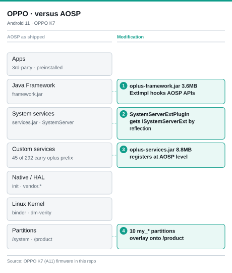
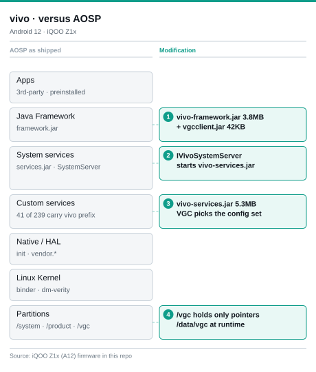
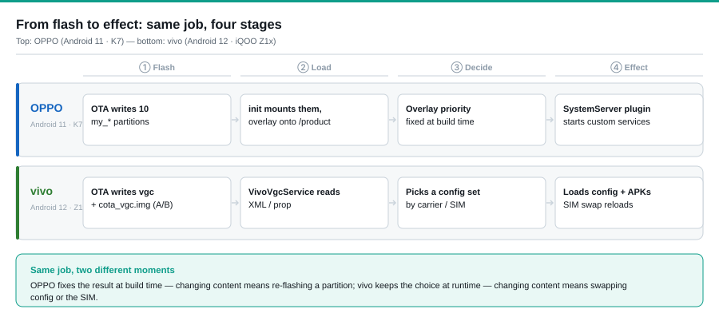

# OV-ExFramework · How OPPO and vivo Customize the AOSP Framework

**English** · [中文](README.md)

OPPO and vivo both take one AOSP baseline and ship it to different carriers, regions and enterprise customers. Each of those asks for its own changes — a carrier wants a different boot animation, a regional team wants a different preinstall list, an enterprise customer wants a different lock screen — and none of them is willing to wait for the others, or to re-flash a whole device because someone else's change went in.

That produces three hard requirements:

- **Customization must not touch AOSP source.** Patch the framework and you have to re-merge it every year with the new Android release — a few rounds of that and nobody dares upgrade.
- **Customization must be packaged, shipped and rolled back on its own**, without dragging everything else along.
- **One baseline has to produce different variants.** Same hardware, different SIM or different customer, a different system comes out.

Both vendors end up with the same shape: the AOSP boot flow stays as it is, each one drops its own JAR onto the bootclasspath, and hooks a single entry point inside `SystemServer` where its services get registered. Customization code grows out of that entry point, so packaging, shipping and rollback never touch AOSP.

The only real difference is the last mile — **how the customization content reaches the device**:

- **OPPO**: content is made of files, written into 10 `my_*` partitions and overlaid onto `/product` at boot.
- **vivo**: the partition stores nothing but directory pointers; a system service reads config at runtime and decides which set to mount.

OPPO freezes the difference into the image; vivo keeps the choice for runtime. That one point changes version granularity, rollback and team boundaries.

Every claim above can be checked against the original files in this repo: where the JARs sit on the bootclasspath, what changed in `SystemServer`, the 45 / 41 extra services, and where the customized content finally gets mounted.

---

## 1. Overall design: one AOSP grid, each vendor's modification points

  
  

Grey bands are AOSP as shipped; green cards are the modification points. Points ①–④ sit on the same row in both figures, so the same layer can be read across.

- **① Framework layer**: neither touches AOSP source — each drops its own JAR on the `bootclasspath`. OPPO adds `oplus-framework.jar` and works through ExtImpl; vivo adds `vivo-framework.jar` plus `vivo-vgcclient.jar`.
- **② System services**: both change how `SystemServer` starts things, in different forms. OPPO reflects through `SystemServerExtPlugin` to get `ISystemServerExt`; vivo takes an `IVivoSystemServer` instance directly.
- **③ Custom services**: 45 of OPPO's 292 services carry an `oplus` prefix, all implemented inside `oplus-services.jar`. 41 of vivo's 239 carry a `vivo` prefix, and VGC only decides which config set to read.
- **④ Partition layer**: this is where they split. OPPO builds customization into 10 `my_*` partitions and overlays them onto `/product`; vivo's `/vgc` holds only pointers, the config itself lives in `/data/vgc`.

---

## 2. OPPO: content injected as files (partition overlay)

| Layer | What it is | Evidence |
|---|---|---|
| Hook | `oplus-framework.jar` 3.6MB · `oplus-framework-telephony.jar` 0.3MB · `oplus-support-wrapper.jar` 0.1MB | `bootclasspatch.txt`: sits right after `framework.jar … ims-common.jar`, before the APEX modules |
| Service entry | `oplus-services.jar` 8.8MB, `SystemServerExtPlugin` reflects to `ISystemServerExt` | `oplus-exsystemserver-analyz-20221102.drawio` |
| Custom services | 45 of 292 system services carry the `oplus` prefix | `service_list.txt`: `OPLUSExService` · `OplusCarService` · `app_compatibility` · `color_screenshot` … |
| Custom content | 10 `my_*` partitions | `mount.txt`, the actual mount points of all 10 |
| Effect | overlay onto `/product/{app, priv-app, lib, overlay}` | priority resolved at build time |

**Idea: building blocks.** One requirement equals one layer of content in one partition. The carrier team owns `my_carrier`, the regional team owns `my_region`, the enterprise customer owns `my_company` — nobody edits the same code, so they can ship in parallel and roll back independently.
**Cost:** the combination space explodes. You maintain a version compatibility matrix across partitions, and once the overlay priority chain is wrong, debugging means walking the whole chain.

---

## 3. vivo: content injected as service config (AIDL + configuration)

| Layer | What it is | Evidence |
|---|---|---|
| Hook | `vivo-framework.jar` 3.8MB · `vivo-vgcclient.jar` 42KB · `framework-adapter.jar` 35KB · `soc-framework.jar` 894B | `bootclasspath.txt`: sits right after `WfdCommon.jar` |
| Service entry | `vivo-services.jar` 5.3MB, `IVivoSystemServer` hands out the instance | `vivo-exsystemserver-analyz-20221102.drawio` · `vivo_iqoo/vivoSystemAdapter.drawio` |
| Custom services | 41 of 239 system services carry the `vivo` prefix | `servicel.txt`: `cbs_service (IVivoCbsService)` · `configuration_service` · `capacitykey_service` … |
| Custom content | `/vgc` partition (pointers only) plus `/data/vgc` runtime config | `mount.txt`: `/dev/block/dm-9 on /vgc type ext4 (ro)` |
| Effect | services read XML / prop and stack config by carrier | measured on A16: swapping the SIM reloads the set, no OTA needed |

**Idea: turn-by-turn navigation.** The partition only stores where to look, never the config itself; a system service reads XML / prop at runtime and decides what actually applies. Swap the SIM and the whole customization set reloads; A/B images also roll back without a re-flash.
**Cost:** monolithic coupling. All customization logic sits in one JAR (18.1MB, dual DEX on A16), so a one-line change ships the whole package, and parallel requirements collide.

---

## 4. From flash to effect: the same job in four stages

  

---

## 5. Side by side

| Dimension | OPPO | vivo |
|---|---|---|
| **Injection surface** | File system: partitions + overlay | System service: AIDL + config |
| **Hook** | `oplus-framework.jar` on the bootclasspath, ExtImpl extends AOSP APIs | `vivo-framework.jar` on the bootclasspath, AIDL exposes `IVivoSystemServer` |
| **Service entry** | `SystemServerExtPlugin` reflects to `ISystemServerExt` | `IVivoSystemServer` hands out the instance; `VivoVgcService` from A16 |
| **Unit of customization** | One partition / one overlay layer / one oplusex module | One config set (carrier / region / vivo dimensions) |
| **When it takes effect** | Priority fixed at build time, frozen once the boot overlay is done | Read at runtime, reloadable on SIM swap |
| **Version granularity** | Per partition, so you only push the one that changed | One version for the whole vgc partition; A/B images on A16 |
| **Rollback** | Re-flash that partition | A/B slot, no visible downtime |
| **Engineering coupling** | Low: partitions and modules can be developed independently | High: customization logic concentrated in one large JAR |
| **Main risk** | Compatibility matrix across partition combinations | Blast radius of a single-package change |
| **Fits best when** | Many customers, many combinations, parallel delivery | Customization follows the SIM / carrier, OTA safety matters |

---

## Data sources

| Device · Android | What was collected |
|---|---|
| **OPPO K7** · Android 11 | `oplus-framework.jar` and the rest of `framework` · `service_list.txt` · `bootclasspath` · `mount.txt` · `prop.txt` · `df.txt` |
| **iQOO Z1x** · Android 12 | `vivo-framework.jar` and other JARs · `servicel.txt` · `bootclasspath` · `mount.txt` · `df.txt` |
| **OPPO PLT120** · Android 16 **vivo V2528A** · Android 16 **vivo V2307A** · Android 15 | Latest `framework` / `services` JARs, system service lists, partitions and mount chain on those devices |

> This repository is for study and technical research only. Firmware, system files and trademarks mentioned here belong to their respective vendors.
