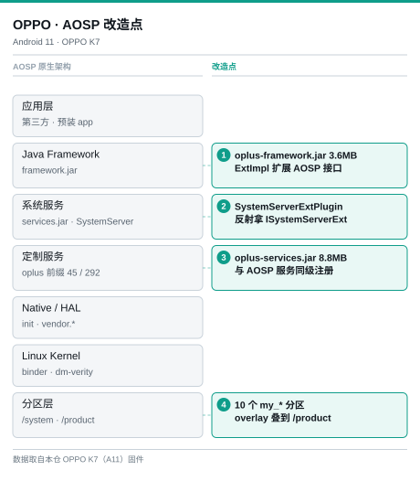
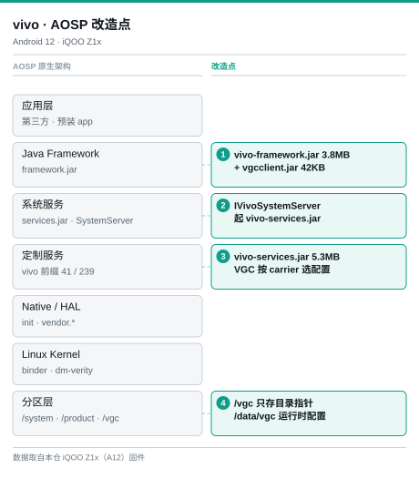
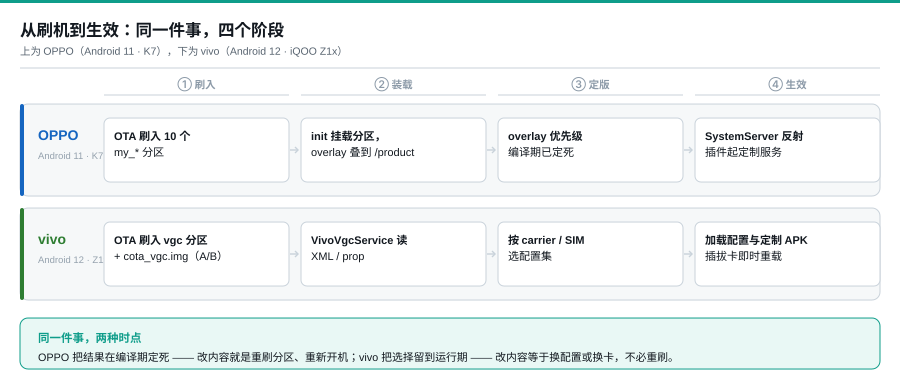

# OV-ExFramework · OPPO / vivo 系统定制框架拆解

**中文** · [English](README.en.md)

OPPO 和 vivo 都要用一套 AOSP 覆盖不同运营商、地区和客户。这些需求各改各的 —— 运营商改开机动画，地区改预装，企业客户改锁屏 —— 彼此不等，也没人愿意为别人的改动重刷整机。

这带来三条硬要求：

- **定制不能改 AOSP 源码**。改了就得跟着每年的大版本重新合一遍，合多几次就没人敢升。
- **定制要能单独打包、单独发版、单独回退**，不能牵一发动全身。
- **同一份基线要能落出不同形态**，同一台机器换个 SIM 卡或换个客户，出来的系统就不一样。

两家给出的答案，形状其实一样：AOSP 的启动流程一行不动，各自在 bootclasspath 塞一个自家 JAR，在 SystemServer 挂一个入口，把自家服务注册进去。定制代码从这个入口长出来，打包、发版、回退都不牵扯 AOSP。

差别只在最后一公里 —— **定制内容怎么落到设备上**：

- **OPPO**：内容做成文件，塞进 10 个 `my_*` 分区，开机 overlay 叠到 `/product`
- **vivo**：分区里只放目录指针，系统服务运行时读配置，决定挂哪一套

前者把差异固化在镜像里，后者把差异留到运行期。就这一点不同，版本粒度、回滚方式、团队分工全都不一样。

上面每一条都能在仓内原始文件里核对：bootclasspath 位置、SystemServer 改动、45 / 41 个定制服务、分区挂载。

---

## 一、总体设计：同一套 AOSP 分层，两家各自的改造点

  
  

灰色条是 AOSP 原生分层，绿色卡片是改造点。编号 ①–④ 在两图中落在同一行，同一层两家改了什么，横着看即可。

- **① Framework 层**：两家都不碰 AOSP 源码，只在 `bootclasspath` 插自家 JAR —— OPPO 插 `oplus-framework.jar`，走 ExtImpl；vivo 插 `vivo-framework.jar` + `vivo-vgcclient.jar`。
- **② 系统服务层**：两家都改 `SystemServer` 的启动路径，但形态不同 —— OPPO 用 `SystemServerExtPlugin` 反射拿 `ISystemServerExt`，vivo 直接拿 `IVivoSystemServer` 实例。
- **③ 定制服务**：OPPO 45 / 292 条带 `oplus` 前缀，实现全压 `oplus-services.jar`；vivo 41 / 239 条带 `vivo` 前缀，VGC 只决定读哪套配置。
- **④ 分区层**：这是真正的分叉 —— OPPO 把定制做进 10 个 `my_*` 分区、overlay 到 `/product`；vivo 的 `/vgc` 只存目录指针，配置本体在 `/data/vgc`。

---

## 二、OPPO：注入面 = 文件系统（分区 overlay）

| 层 | 实体 | 证据 |
|---|---|---|
| 挂钩层 | `oplus-framework.jar` 3.6MB · `oplus-framework-telephony.jar` 0.3MB · `oplus-support-wrapper.jar` 0.1MB | `bootclasspatch.txt` 原文：紧跟在 `framework.jar … ims-common.jar` 之后、APEX 模块之前 |
| 服务入口 | `oplus-services.jar` 8.8MB，`SystemServerExtPlugin` 反射拿 `ISystemServerExt` | `oplus-exsystemserver-analyz-20221102.drawio` |
| 定制服务 | 292 个系统服务中 45 个带 `oplus` 前缀 | `service_list.txt`：`OPLUSExService` · `OplusCarService` · `app_compatibility` · `color_screenshot` … |
| 定制内容 | 10 个 `my_*` 分区 | `mount.txt` 里 10 个分区实际挂载点 |
| 生效 | overlay 叠加到 `/product/{app, priv-app, lib, overlay}` | 优先级编译期确定 |

**设计理念：砌积木。** 一个定制需求 = 一个分区里的一层内容。运营商管 `my_carrier`、地域团队管 `my_region`、企业客户管 `my_company`，彼此不碰同一份代码，可并行开发、独立发版、独立回滚。
**代价：** 分区组合爆炸 —— 要维护版本兼容矩阵；overlay 优先级链一旦叠错，排障要理解整条链。

---

## 三、vivo：注入面 = 系统服务（AIDL + 配置）

| 层 | 实体 | 证据 |
|---|---|---|
| 挂钩层 | `vivo-framework.jar` 3.8MB · `vivo-vgcclient.jar` 42KB · `framework-adapter.jar` 35KB · `soc-framework.jar` 894B | `bootclasspath.txt` 原文：紧跟 `WfdCommon.jar` 之后 |
| 服务入口 | `vivo-services.jar` 5.3MB，`IVivoSystemServer` 拿实例 | `vivo-exsystemserver-analyz-20221102.drawio` · `vivo_iqoo/vivoSystemAdapter.drawio` |
| 定制服务 | 239 个系统服务中 41 个带 `vivo` 前缀 | `servicel.txt`：`cbs_service (IVivoCbsService)` · `configuration_service` · `capacitykey_service` … |
| 定制内容 | `/vgc` 分区（存目录指针）+ `/data/vgc` 运行时配置 | `mount.txt`：`/dev/block/dm-9 on /vgc type ext4 (ro)` |
| 生效 | 服务读 XML / prop，按 carrier 维度叠加 | A16 实测：SIM 插拔触发重载，不需 OTA |

**设计理念：智能导航。** 分区只存「去哪里找配置」，不存配置本体；真正生效由系统服务在运行期读 XML/prop 决定。所以 SIM 一换就能重载整套定制，A/B 镜像还能无感回滚。
**代价：** 单块耦合 —— 定制逻辑全压在一个 JAR 里（A16 实测 18.1MB、双 DEX），改一行要发整包；多个定制需求同时推进容易撞车。

---

## 四、从 OTA 到生效：两条链路

  

---

## 五、设计理念对齐表

| 维度 | OPPO | vivo |
|---|---|---|
| **注入面** | 文件系统：分区 + overlay | 系统服务：AIDL + 配置 |
| **挂钩方式** | bootclasspath 插 `oplus-framework.jar`，ExtImpl 扩展 AOSP 接口 | bootclasspath 插 `vivo-framework.jar`，AIDL 暴露 `IVivoSystemServer` |
| **服务入口** | `SystemServerExtPlugin` 反射拿 `ISystemServerExt` | `IVivoSystemServer` 拿实例；A16 起为 `VivoVgcService` |
| **定制单元** | 一个分区 / 一层 overlay / 一个 oplusex 模块 | 一个配置集（carrier / region / vivo 维度） |
| **生效时机** | 编译期确定优先级，开机 overlay 后固定 | 运行期读配置，SIM 插拔可重载 |
| **版本粒度** | 分区独立版本，可只推变化的那个 | 整个 vgc 分区一个版本；A16 用 A/B 镜像 |
| **回滚** | 分区级重新刷入 | A/B slot 无感回滚 |
| **工程耦合** | 低：分区、模块可独立开发 | 高：定制逻辑集中在单个大 JAR |
| **主要风险** | 分区组合的兼容矩阵爆炸 | 单包改动的连带影响面大 |
| **适合场景** | 客户多、定制组合多、要并行交付 | 定制跟着 SIM / 运营商走、对 OTA 安全要求高 |

---

## 数据来源

| 机型 · 系统 | 取到的内容 |
|---|---|
| **OPPO K7** · Android 11 | `oplus-framework.jar` 等 `framework` 目录 JAR · `service_list.txt` · `bootclasspath` · `mount.txt` · `prop.txt` · `df.txt` |
| **iQOO Z1x** · Android 12 | `vivo-framework.jar` 等 JAR · `servicel.txt` · `bootclasspath` · `mount.txt` · `df.txt` |
| **OPPO PLT120** · Android 16 **vivo V2528A** · Android 16 **vivo V2307A** · Android 15 | 对应机型最新 `framework` / `services` JAR、系统服务清单、分区与挂载链 |

> 本仓内容仅供学习与技术研究参考，涉及的固件、系统文件与商标归各厂商所有。
